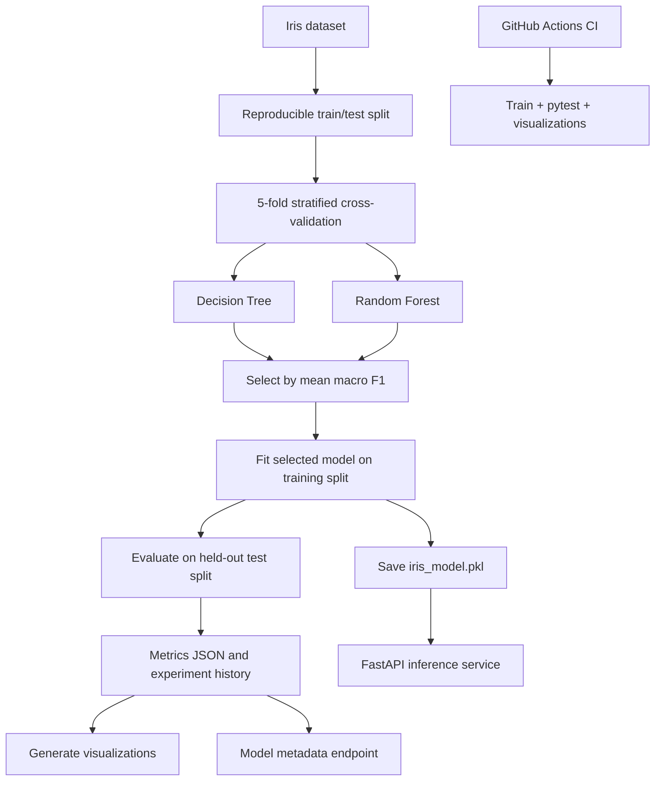
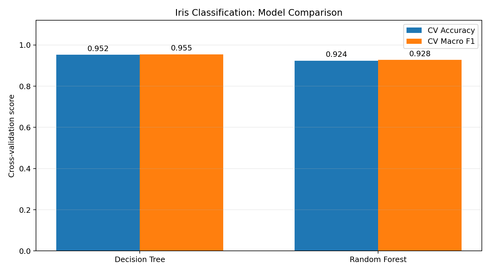
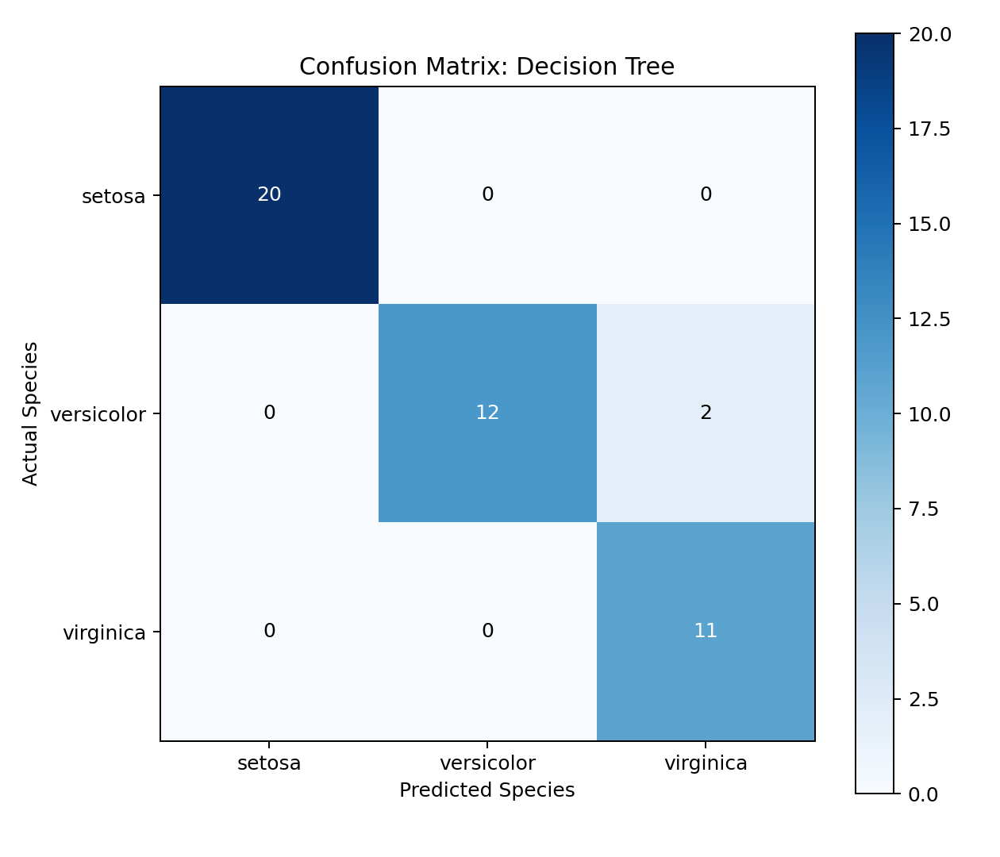
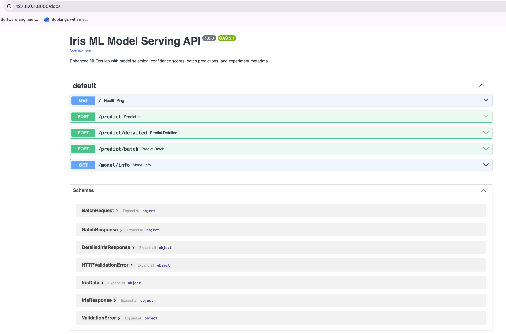
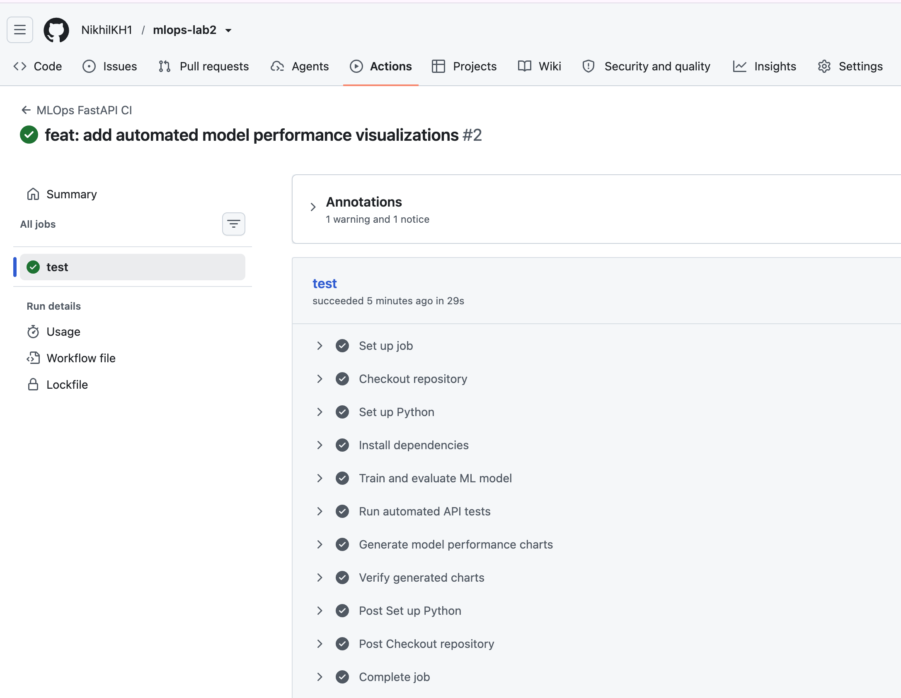

# MLOps Lab 2 — Enhanced FastAPI Model Serving

A reproducible machine-learning workflow for **training, comparing, evaluating, and serving Iris classifiers** with scikit-learn and FastAPI. This is an extended version of the [course FastAPI lab](https://github.com/raminmohammadi/MLOps/tree/main/Labs/API_Labs/FastAPI_Labs) with additional MLOps features, automated tests, and GitHub Actions CI.

## Project highlights

- **Model comparison:** Decision Tree and Random Forest evaluated with 5-fold stratified cross-validation.
- **Reproducible model selection:** Choose the algorithm with the highest mean cross-validation macro F1, then evaluate it on held-out data.
- **Experiment tracking:** Save comparison scores, metrics, confusion matrix, training time, environment version, and training history.
- **Enhanced inference API:** Single and batch predictions, species names, probability estimates, request validation, and model metadata.
- **Automated quality checks:** pytest tests and GitHub Actions CI that retrains and tests the application.
- **Performance reporting:** Generate a model comparison plot and confusion matrix directly from experiment results.

## Architecture



## Original lab vs. enhancements

| Course starter | This implementation |
|---|---|
| Train one Decision Tree classifier | Compare Decision Tree and Random Forest with cross-validation |
| Save one model file | Save selected model, performance metrics, and model metadata |
| Basic single-prediction API | Detailed predictions, batch inference, model information |
| Basic request schema | Positive-valued feature validation and batch-size limits |
| Manual endpoint checks | Automated API and error-path tests |
| No CI pipeline | GitHub Actions runs training, tests, and plot generation |
| No experiment charts | Model comparison chart and confusion matrix |

## Results

These results are from the recorded local experiment using the Iris dataset and random seed `12`. Cross-validation results are measured on the training partition; the final test set is held out until the selected model is evaluated.

| Algorithm | 5-fold CV accuracy | 5-fold CV macro F1 |
|---|---:|---:|
| **Decision Tree** | **95.24%** | **95.50%** |
| Random Forest | 92.38% | 92.77% |

**Selected model:** Decision Tree (higher cross-validation macro F1).

| Final held-out test metric | Value |
|---|---:|
| Accuracy | **95.56%** |
| Macro F1 | **94.66%** |
| Final model fitting time | 0.0003 s |

> The fitting time measures only the final `.fit()` call, **not** cross-validation, preprocessing, or end-to-end training. Scores and runtimes can vary if the dataset split, software versions, or machine change.

### Model comparison chart



### Confusion matrix



Both figures are generated from `results/latest_metrics.json` by `src/visualize.py`—they are not manually entered plots.

## API demonstration screenshots

### Swagger UI — enhanced endpoints

The Swagger UI shows the five available routes, including the new detailed-prediction, batch-prediction, and metadata APIs.



### GitHub Actions — successful CI run

The CI workflow installs dependencies, trains the model, executes automated tests, and verifies that charts are generated.



> The screenshot filenames above must exist under `assets/screenshots/` for these images to render on GitHub.

## Technology stack

| Category | Tools |
|---|---|
| Machine learning | Python, scikit-learn, Iris dataset |
| Serving | FastAPI, Uvicorn, Pydantic |
| Model artifact | Joblib (`.pkl`) |
| Experiment records | JSON and JSONL |
| Visualizations | Matplotlib |
| Tests | pytest, HTTPX, FastAPI TestClient |
| Continuous integration | GitHub Actions |

## Repository structure

```text
mlops-lab2/
├── .github/workflows/ci.yml
├── assets/screenshots/
│   ├── swagger-ui.png
│   └── ci-success.png
├── model/
│   ├── .gitkeep
│   ├── model_metadata.json
│   └── iris_model.pkl           # generated locally; not tracked in Git
├── results/
│   ├── latest_metrics.json
│   ├── history.jsonl
│   └── figures/
│       ├── model_comparison.png
│       └── confusion_matrix.png
├── src/
│   ├── data.py
│   ├── main.py
│   ├── predict.py
│   ├── train.py
│   └── visualize.py
├── tests/test_api.py
├── requirements.txt
├── requirements-dev.txt
└── README.md
```

## Quick start

**Requirements:** Python 3.11 recommended, Git, and pip. Commands below use macOS/Linux syntax.

### 1. Clone and install

```bash
git clone https://github.com/YOUR_USERNAME/mlops-lab2.git
cd mlops-lab2
python3 -m venv .venv
source .venv/bin/activate
python -m pip install --upgrade pip
python -m pip install -r requirements-dev.txt
```

Replace `YOUR_USERNAME` with the username of the submitted GitHub repository. `requirements-dev.txt` also installs the application's dependencies.

### 2. Train and evaluate models

From the project root:

```bash
python src/train.py
```

This will generate `model/iris_model.pkl`, `model/model_metadata.json`, `results/latest_metrics.json`, and an appended record in `results/history.jsonl`. The model binary is deliberately excluded from Git; **run training before starting the API on a fresh clone**.

### 3. Generate the figures

```bash
python src/visualize.py
```

Charts are saved under `results/figures/`.

### 4. Run the API

```bash
cd src
python -m uvicorn main:app --reload
```

Open the interactive docs at **http://127.0.0.1:8000/docs**. The `--reload` option is for local development only.

### 5. Run automated tests

Open a second terminal in the repository root with the virtual environment activated:

```bash
python -m pytest tests/ -v
```

The test client runs without a live Uvicorn server. A fresh checkout must have a trained model artifact before inference tests run; the CI workflow handles this by training first.

## API reference

| Method | Route | Function |
|---|---|---|
| `GET` | `/` | Basic health response |
| `POST` | `/predict` | Original class-ID prediction (backwards compatible) |
| `POST` | `/predict/detailed` | Species name and prediction confidence |
| `POST` | `/predict/batch` | Detailed predictions for 1–100 samples |
| `GET` | `/model/info` | Saved training and model metadata |

### Single prediction

`POST /predict`

```json
{
  "sepal_length": 5.1,
  "sepal_width": 3.5,
  "petal_length": 1.4,
  "petal_width": 0.2
}
```

Example response:

```json
{"response": 0}
```

Classes: `0 = setosa`, `1 = versicolor`, `2 = virginica`.

### Detailed prediction

`POST /predict/detailed` accepts the same request and returns a response in this format:

```json
{
  "response": 0,
  "species": "setosa",
  "confidence": 1.0
}
```

The confidence field is the classifier's estimated probability for its predicted class, **not a calibrated reliability guarantee**. The value shown is illustrative.

### Batch prediction

`POST /predict/batch`

```json
{
  "instances": [
    {"sepal_length": 5.1, "sepal_width": 3.5, "petal_length": 1.4, "petal_width": 0.2},
    {"sepal_length": 6.7, "sepal_width": 3.0, "petal_length": 5.2, "petal_width": 2.3}
  ]
}
```

The response includes a `predictions` array with a class ID, species, and confidence per sample, plus a `count` of predictions.

### Model metadata

`GET /model/info` reads `model/model_metadata.json` and reports the model version, algorithm, training timestamp, test metrics, and input features.

### Validation and errors

- The four flower measurements are required and must each be greater than zero.
- Empty batches and batches larger than 100 are rejected.
- Invalid input returns HTTP **422**.
- Missing model metadata returns HTTP **503**.
- If the trained model is missing, prediction endpoints return HTTP **503**.

## Experiment tracking and reproducibility

- The model-selection metric is **mean 5-fold cross-validation macro F1**.
- The final accuracy and macro F1 are measured on the held-out test partition.
- `results/latest_metrics.json` stores the most recent experiment, including model comparisons, test metrics, and the confusion matrix.
- `results/history.jsonl` keeps one JSON record per training run.
- `model/model_metadata.json` stores the selected model's description, metrics, and training timestamp.
- Model loading is cached for serving efficiency; **restart the API after retraining** to load the updated model artifact.

## Automated tests and CI

The pytest suite checks successful predictions, batch responses, invalid/missing input fields, batch limits, model metadata, and failure responses.

GitHub Actions (`.github/workflows/ci.yml`) runs on pushes and pull requests and performs:

1. Checkout and Python environment setup.
2. Dependency installation.
3. Model training and evaluation.
4. Automated API tests.
5. Chart generation and artifact existence checks.

This is **continuous integration**, not a cloud deployment; the API is run locally for this lab.

## Limitations and possible next steps

- Iris is a small educational dataset, not a production-scale benchmark.
- Probability estimates have not been calibrated.
- Experiment records are file-based rather than stored in an MLflow tracking server.
- The API is not deployed publicly and does not implement production monitoring or model-drift detection.

Future improvements could include MLflow, Docker packaging, model registry integration, and deployment monitoring; these are **not required** to reproduce the current lab.

## Attribution

Based on **Ramin Mohammadi's MLOps FastAPI Lab 1**, used as the course starter:

- [Original course repository](https://github.com/raminmohammadi/MLOps/tree/main/Labs/API_Labs/FastAPI_Labs)
- [Original FastAPI Lab 1 walkthrough](https://www.mlwithramin.com/blog/fastapi-lab1)

This repository adds the model-comparison workflow, experiment tracking, API extensions, tests, CI, and visualizations described above.
